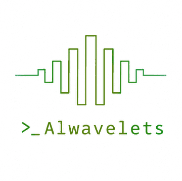

<p align="center">
  <picture>
    <source media="(prefers-color-scheme: dark)" srcset="assets/alwavelets-logo.png">
    _ Alwavelets wordmark">
  </picture>
</p>

# Alwavelets — Terminal VCD/FST Waveform Viewer

[](LICENSE)

A dependency-free terminal waveform viewer for digital-design simulation
traces. Runs over SSH / tmux / a bare console — no display server required.

The mark is a symmetric burst of square waves over a `>_` prompt — the shape
of a signal, drawn the way this tool draws one. It ships in two tints so it
holds contrast on either GitHub theme (`assets/alwavelets-logo.png` for dark,
`…-logo-light.png` for light). The in-app `◆` diamond icon used for desktop
entries is separate, generated from scratch by `tools/make_icon.py` — pure
stdlib, original artwork, no third-party assets.

## Features

- **Formats:** VCD (streaming, background, and disk-backed loading for large
  files; aliased identifier codes and `b`-form 1-bit values included) and FST
  read natively — zlib, LZ4 and FastLZ chains and hierarchies, gzip-wrapped
  files, aliases, `$dumpoff` blackouts — with pure-Python block decoders, so
  Verilator, GHDL, Icarus and `vcd2fst` output opens with no extra package
  (`fst2vcd` is only a fallback for anything the reader rejects). Values are
  bit-packed in memory (1-bit signals and all buses up to 64 bits), cutting
  resident size several-fold on bus-heavy traces.
- **Navigation:** fuzzy signal finder (`/` filters every signal in the file
  live, fzf-style), edge-to-edge jumps, multi-cursor measurement, markers,
  zoom-to-fit / zoom-to-selection, mouse drag-to-zoom, time goto, vim-style
  motions.
- **Display:** binary / hex / dec / unsigned radixes, analog rendering,
  per-signal color & height, IEEE-754 float decode, scope folding, themes, and
  sub-cell (2× horizontal resolution) waveforms for finer clock timing (`w`),
  collapsible signal groups — nestable via `group parent/child` — (fold with
  Tab), and true-color
  themes (`#rrggbb` in theme JSON; quantizes gracefully on 256-color
  terminals — see `theme_nord.json`).
- **Analysis:** frequency & transition detection, cross-signal expression
  search (`when valid && state==3 && addr>=0x40`), glitch / x-hazard detection,
  pattern/trigger search,
  protocol decoders (SPI, I²C, UART, AXI, Wishbone, AHB), RISC-V instruction
  trace decoding, formal counter-example & power-activity analysis.
- **Persistence:** whole-session save/restore (`;session` writes a sidecar
  that reopens the trace with the same layout, groups, radixes, colors, zoom
  and theme), plus bookmarks, annotations/notes, signal tags, and saved
  arrangements stored as JSON sidecar files next to the trace; **GTKWave
  `.gtkw` import/export** for interop (`loadgtkw`/`savegtkw`); a persistent
  parse cache for instant re-opens.
- **Export:** CSV, SVG, PDF, screenshot, and a **pixel-accurate image** shown
  inline on kitty / iTerm2 / sixel terminals (falls back to a saved PNG, and to
  the normal character-cell rendering, everywhere else — never hinders portability).
- **Scripting:** a small TCL-like command engine and an in-app command line.

The compact title and shortcut bars leave more room for waveforms. The guide
fits shortcuts to the terminal width; `0` / `9` page through them, `F2` hides
the guide, and `?` opens quick help. The dark theme uses quiet panel colors and
a subtle A–B measurement region. Sidebar labels truncate at character-cell
boundaries, and the status bar keeps complete readouts together while giving
loading, errors, and agent-control activity priority on narrow terminals.

Three selectable **workmodes** combine a palette with presentation defaults:

| Mode | Appearance |
| --- | --- |
| `calm` | Muted waveform colors, compact guide, quieter panels, scope separators |
| `classic` (default) | Vivid waveform colors, dense shortcuts and technical statistics, contiguous signal rows |
| `minimal` | Monochrome, plain panel bars, no row striping or scope separators, guide hidden |

Press **F3** to cycle modes, or enter `;workmode calm`, `;workmode classic`, or
`;workmode minimal`. The title shows the active mode even when the guide is
hidden; **F2** toggles the guide in any mode. Switching modes reapplies the
palette, guide, scope-separator, and zero-spacing defaults while keeping the
displayed signals, zoom, cursors, and per-signal settings. `;theme` and `\`
still change only the palette. `;session` saves the mode and any subsequent
appearance adjustments for that trace.

Clock edges snap to the nearest terminal column. At zoom levels where a
half-period spans a fractional number of columns, equal pulses can still
differ by one column in width. Press `w` to select **Hi-res (sub-cell)** for
half-column resolution, or zoom in for more detail. Dense activity that cannot
be resolved is shown with a busy glyph; displayed pulse widths are approximate,
while cursor time measurements use the trace timestamps.

Keyboard zoom keeps the visible active cursor at its screen position; mouse-wheel
zoom keeps the time under the pointer in place. With a hidden or off-screen
cursor, keyboard zoom uses the center of the view. Positions round to trace
ticks, and zooming out stops the left edge at time zero. The optional grid (`Q`)
follows the ruler ticks, dims stable waveform cells, and draws dotted marks in
empty cells while preserving transitions and labels.

## Requirements

- Python 3.8+ with the standard library `curses` module (Unix/Linux/macOS;
  Windows is not supported because `curses` is not in the stdlib there).

No third-party packages are required.

## Usage

```sh
python3 alwavelets.py <file.vcd>
python3 alwavelets.py <file.vcd> --signals 'clk,data*,alu.*'
python3 alwavelets.py --demo            # generate and open a built-in example
```

Or from a Python REPL, with no curses terminal involved:

```python
>>> import alwavelets
>>> vcd = alwavelets.demo()      # prints a waveform, returns the parsed trace
```

Flags:

| Flag | Meaning |
| --- | --- |
| `--signals`, `-s` | Comma-separated name/glob filters |
| `--sync` | Force synchronous parse (disable background loading) |
| `--storage auto\|memory\|disk` | Use disk above 50 MiB, for large declaration counts, or large FST expansion; override either way |
| `--memory-mib N` | Decoded waveform page-cache budget, default 256 MiB |
| `--loadunchecked` | Start with no signals shown (pick them in the `B` tree browser) |
| `--expanded` | Start with all scope modules expanded |
| `--workmode calm\|classic\|minimal` | Choose UI presentation, overriding config and saved appearance |
| `--demo` | Generate and view a demo trace (written under a per-user temp directory) |
| `--mcp` | Run as an MCP server (stdio) instead of the viewer |
| `--no-cache` | Disable persistent waveform and instruction caches |
| `--cache-dir PATH` | Cache directory; overrides `ALWAVELETS_CACHE_DIR` and the default XDG location |
| `--waveform-cache-mib N` | Saved waveform cache retention quota in MiB, unlimited by default; 0 disables reuse and saving |
| `--list-waveform-cache` | Print cache entries, sizes, busy status, usage, and free disk space as JSON, then exit |
| `--remove-waveform-cache NAME` | Remove one idle entry by its exact listed name; repeat for multiple entries |
| `--purge-waveform-cache` | Remove all idle waveform caches and checkpoints, then exit |
| `--purge-partial-indexes` | Remove only idle incomplete VCD/FST indexes, then exit |
| `--analysis-cache-mib N` | Saved instruction-index quota, default 8192 MiB; 0 disables reuse and saving |
| `--purge-analysis-cache` | Remove saved instruction indexes and exit |
| `--no-config` | Ignore `~/.config/alwavelets/config.json` |
| `--no-session` | Ignore a saved session sidecar (open the trace fresh). `--expanded` / `--loadunchecked` imply this |
| `--control` | Expose a token-authenticated control socket so an authorized local agent can drive this live session (see [SKILL.md](SKILL.md)) |
| `--list-sessions` | Print controllable running viewers as JSON, then exit |
| `--jobs`, `-j` | Opt-in parallel parse workers for a large (>16 MB) synchronous parse (e.g. `--sync --jobs 8`) |

Parallel workers use `forkserver` where supported and `spawn` elsewhere, so
they do not inherit the viewer's threads and locks. Library scripts requesting
parallel parsing must guard their entry point with `if __name__ == '__main__':`.
The low-level `parse_parallel_file` API accepts an optional `mp_context`;
`parse_file` falls back to sequential parsing when workers cannot start or fail.
Worker startup and merging add overhead, so `--jobs` remains opt-in and applies
to in-memory VCD parsing (`--storage memory --sync --jobs 8`).

### Very large traces

VCD and FST files above 50 MiB automatically use an indexed SQLite trace store.
Smaller VCDs also use disk when their declaration count predicts large metadata
allocations, even if their waveform history is short.
For smaller native FSTs, automatic selection also examines uncompressed block
sizes, timestamp counts, and declaration counts. Gzip-wrapped FSTs use disk
storage conservatively, since inspecting their inner block layout requires
decompression. `--storage memory` remains an explicit override.
Every declared signal remains available. `--signals`, `--loadunchecked`, and
tree selection remain optional display controls; disk mode does not require a
signal shortlist. To force disk storage or choose a smaller page cache:

```sh
alwavelets huge.vcd --storage disk --memory-mib 64
alwavelets huge.fst --storage disk --loadunchecked
```

The first open scans the source and batches declaration writes. Short histories
(up to eight events and 512 encoded bytes) stay in the signal catalog; longer
histories use independently compressed pages. VCD events and FST initial values
use bounded batches with bulk metadata lookups and periodic publication.
VCD batches preserve same-timestamp event order, and longer histories retain
their page buffers across input batches. Declaration serialization reuses common
type/scope fields while preserving existing saved-session fingerprints.
Pages, summaries, and timestamp/count updates also use bounded write batches.
Buffered histories keep their own event offsets and last timestamps. Completed
pages carry that state in the bounded write queue, and each drain updates both
metadata fields together. A read-through cache holds at most 1,024 stored
positions; it does not write metadata on eviction. Checkpoints still flush all
buffered state before committing, and existing complete and partial indexes
remain compatible.

FST timestamp deltas expand in bounded pages as signal chains request them, so
the first waveform batches can publish before the whole timestamp table has
been converted. Expanded pages are retained for later signals and spill to disk
under the same memory budget. Every declared timestamp is still validated
before its block completes, including timestamps unused by any signal.

The first available histories publish promptly. Completed pages and progress
normally publish every quarter second; later partial pages can accumulate for
about a second, or until page/memory limits require a flush. Finishing a load
always publishes all remaining values. Existing prepared indexes remain usable.
Opening a native VCD/FST now shows a loading screen before storage detection,
decompression, declaration parsing, or scope-index upgrades. Preparation runs on
a worker; the screen shows the current stage, available byte/scope counts, and
elapsed time. Press Esc, q, or Ctrl-C to cancel. Cleanup finishes on the worker,
including temporary files and any unclaimed trace. Existing durable checkpoints
remain available for resuming; preparation before the first checkpoint must be
repeated. The same opening screen supports `--storage memory`, including eager
cache reads and writes. `--sync`, demo generation, and converted legacy formats
retain their synchronous startup path.
The screen transitions into the viewer when metadata is ready, and disk
waveforms become available as indexing progresses. Cached opens wake the UI
immediately when ready, without a fixed polling delay. Signal selection remains
optional. Rows and cursor values load on a background worker; panning
discards obsolete requests. Complete analyses wait until indexing finishes.
The index includes signal/time lookups and a hierarchy of exact min/max
summaries, so overview scaling need not decode the whole history. Reopening an
unchanged source opens the signal catalog and fetches declarations and values
on demand, without reconstructing every signal object.
Changed sources and incompatible index formats rebuild the index.

FST disk ingestion keeps ordinary bus values packed through page writing,
including buses wider than 64 bits, and computes numeric ranges while decoding.
Uncommon logic characters keep their text representation. Public value reads,
rendering, and exports still return the same logic strings. New FST indexes use
version 8; complete and resumable version-7 indexes remain readable, and resuming
one upgrades its version at the next checkpoint. Older readers rebuild version-8
indexes. Eager parse caches and VCD indexes retain their existing formats.

VCD disk indexing with caching enabled saves a resumable checkpoint after the
header, then roughly every five seconds or 64 MiB of input. Reopening after a
close, cancellation, or process interruption continues at the last checkpoint;
the status bar shows `Resuming` and progress includes the saved work. Checkpoints
atomically save all preceding events, parser state, and unfinished summary
groups. Work since the last checkpoint is replayed. Source identity, size, and
modification/change times must still match; otherwise indexing starts over.
Selective signal loading remains optional, and all declarations are retained
across checkpoints.

FST disk indexing also saves resumable checkpoints with caching enabled. It
records the next block, signal chain, and position within a chain alongside the
waveform pages, counts, and unfinished summaries. Checkpoints follow roughly
five seconds of indexing or 64 MiB of decoded chain data, checked at completed
batches; declaration, initial-frame, and final-sort boundaries are saved too.
Reopening skips completed chains and reuses the declaration catalog. The current
chain rebuilds its decompression history up to the saved byte position, then
continues streaming; saved events are not decoded or written again. Its
timestamp/offset tables are decompressed again, and timestamp expansion rebuilds
the prefix needed at the saved position before proceeding on demand.
Gzip-wrapped FSTs must also be unwrapped again.
An interrupted blackout block or final sort is replayed from its preceding
checkpoint. This reduces repeated work after interruption; it does not remove
the first-load scan or guarantee a checkpoint during a long decompression step.

FST shared-chain decoding now uses the correct one-based handle targets. This
fixes missing or incorrect histories when distinct signals share compressed
chains. FST parse caches, disk indexes, and incomplete checkpoints from the
older decoder rebuild on their next open; VCD caches retain their version.

Caches default to `${XDG_CACHE_HOME:-~/.cache}/alwavelets`. Set `--cache-dir`
or `ALWAVELETS_CACHE_DIR` to put waveform and instruction caches on another
drive. Explicitly choosing a directory also places temporary waveform indexes
there when possible; decompression spill files still use the system temporary
directory (`TMPDIR`). Existing caches are not moved automatically.

Waveform cache retention is unlimited by default. Set `--waveform-cache-mib N`
to evict the least recently used inactive entries on opens, VCD checkpoints,
completion, and close. This covers eager parse caches, completed disk indexes,
incomplete VCD/FST checkpoints, and their SQLite sidecars. It excludes small lock
files, temporary work files, and instruction caches (which have a separate
`--analysis-cache-mib` quota). Open viewers and builders are protected and can
exceed the retention quota; it is not a hard disk-usage limit. A completed index
larger than the quota remains usable until its last viewer closes. Zero disables
waveform cache reuse and saving without deleting existing files.

For example, use a cache on a larger drive with a 20 GiB retention quota:

```sh
alwavelets trace.vcd --storage disk --cache-dir /large-drive/alwavelets --waveform-cache-mib 20480
alwavelets --cache-dir /large-drive/alwavelets --list-waveform-cache
alwavelets --cache-dir /large-drive/alwavelets --remove-waveform-cache 'NAME_FROM_LIST'
```

`--purge-waveform-cache` removes all idle waveform entries;
`--purge-partial-indexes` removes only idle incomplete indexes. Both skip files
held by open viewers. `--no-cache` disables both saving and resuming. If another
viewer owns the partial index or its cache directory is unavailable, opening
uses temporary storage. Small lock files remain in the cache directory so
concurrent opens and cleanup can coordinate safely.

If disk space or a filesystem quota runs out, indexing reports the affected
directory. When a VCD or FST checkpoint has already been committed, the saved data stays
readable and survives closing the viewer, even if it exceeds the retention
quota. Free space and reopen the unchanged source to resume; choosing another
cache directory starts a new index. Later cache maintenance may evict the idle
checkpoint under the normal retention policy. For FST, saved histories can cover
different time ranges per signal while indexing is incomplete.

Time-only queries read just the kind/timestamp prefix of a compressed page,
without decoding its values. A later value read replaces that cache entry with
the complete page; both forms share the same bounded cache. Rendering and event
exports request complete pages when they need values immediately. Small inline
histories are still read whole. Existing disk indexes need no rebuild, and
signal selection remains optional. Prefix reads validate the header and timestamp
length; the full page's zlib checksum is checked when values are read.

Zoomed-out digital rendering samples shared column boundaries once: a 160-column
row needs 161 boundaries, or 321 at subcell resolution. Disk queries combine
each boundary's event ordinal and preceding value, reuse the active page, and
avoid decoding a following page for queries in a gap. Expanded bus bits extract
only sampled values, including for in-memory traces. Duplicate timestamps,
half-open column edges, labels and glyphs retain their existing behavior.
Boundary batches use one published history and check cancellation between
samples. Temporary sample counts scale with screen width; their values and
labels still require space proportional to signal width.

Related rows share raw boundary samples through a separate cache capped at the
smaller of **1 MiB per trace** or **one-eighth of the decoded-page budget**.
It retains timestamps, ordinals and raw values, including an allowance for
entry overhead; it retains no decoded pages. Values too large for an entry are
not cached. A publication or reorder changes the trace generation, invalidating
these samples before the next batch reads them. Left boundaries used for
waveform edges and inclusive point samples used for bus labels remain distinct,
so exact-time delta events keep their existing meaning. Bus labels are read in
one batch, and analog rows reuse their scaling range for the displayed limits.
The page-cache budget is unchanged; the sample cache is additional bounded memory.

Pan, zoom, resize and waveform-style changes cancel obsolete background rows
before the UI reads signal metadata. Scrolling removes pending offscreen rows;
new versions of a row replace its queued work. Requests use a bounded queue
that releases cancelled closures immediately, and each drawing pass submits
its rows before starting new worker jobs. Cancellation belongs to the query,
so file loading and unrelated readers continue. It is cooperative: an ongoing
SQLite operation or page decompression must return before it can be observed.
Large individual values can therefore still delay cancellation. Signal
selection remains optional and existing indexes need no rebuild.

Pages are evicted from a bounded cache while browsing. The budget covers decoded
timestamps and values, **not total process memory**: Python, scopes, display edits, SQLite,
builder buffers, and active query pages need additional memory. A separate cache
of at most 1,024 recent page locations lets nearby cursor, timestamp and ordinal
queries reuse a decoded page without repeating SQLite lookups. These locations
retain no decoded arrays and are valid only while the page remains cached and
the published history is unchanged. FST value chains
stream through bounded decompression history and read buffers without a separate
decompressed-chain file. Frames, hierarchies, handle geometry, block/chain indexes,
and timestamp tables use bounded buffers that spill to temporary files.
zlib, LZ4, FastLZ, and outer gzip decompression process small chunks and check
cancellation. A single declaration name or signal value
can still exceed the working-buffer budget. There is no new native dependency. Disk mode
trades a slower first scan and disk space for low memory use and quick subsequent
opens. `--no-cache` still uses temporary disk storage, removed on close.
Declarations, declaration order, and direct scope membership live in SQLite
during both the first parse and cached reopening. Signal objects use a bounded
cache; held objects and alias masters retain their identity across eviction.
Event counts, ingestion timestamps, and pending summary groups also use bounded
caches. Scope parents, child order, subtree counts, and ordinal bounds also
live in SQLite, with a bounded node cache. Cached opens do not rebuild the
hierarchy. Older complete and resumable indexes get a transactional scope
metadata upgrade without rescanning waveform histories; cancelling that upgrade
leaves the existing index usable. Building and traversing deeply nested scopes
does not depend on Python's recursion limit.
Display order uses compact catalog ranges, with space proportional to the number
of runs and explicit edits. Default module folding and saved views store a fold
level plus exceptions, rather than every folded scope name. Existing sessions
with explicit fold lists remain readable. Highly fragmented selections, explicit
browser expansions, group memberships, or collecting every signal/scope can
still require memory proportional to those edits. Long hierarchical names also
increase index size. All declarations remain available without selecting a shortlist.

The signal browser resolves both scope headers and signal rows on demand.
Expanding a scope does not create one UI entry per child scope or signal; the
row index grows with explicit expansions. The split panel reads the selected
scope directly; subtree counts are persisted and checkmarks are cached.
Home/End and Page Up/Down navigate both tree views.
Scope selection and checkmarks use catalog ranges. Contiguous scopes can be
toggled without visiting each signal; interleaved declarations may require a
scan to find their runs. Reordering, undo, and small display groups preserve
the surrounding ranges. Finder navigation snapshots also share these runs.

The `/` finder reads names without materializing the catalog. Disk-backed and
large in-memory traces rank fuzzy matches on a cancellable background worker;
typing again discards the previous query. Results are stored on disk and paged,
with no match-count limit. Empty queries show declaration order immediately.
Home/End jump to the first/last result. Full fuzzy matching still scans candidate
names, so completing a broad search can take time while the interface remains
responsive. Small in-memory traces continue to filter immediately.

During background disk indexing, `;cancel` stops the load; closing the viewer
also cancels it. Partial indexes are never treated as complete; cached VCD
checkpoints remain available for resuming. Temporary spill files close on
completion, cancellation, or failure. Library callers can pass a cancellation
event to `FSTReader.parse(cancel=event)` or `storage.open_trace(cancel=event)`.
FST metadata is parsed before the viewer opens; library cancellation also covers
this stage. The prepared reader shares metadata with the viewer and retains
unwrapped input for background indexing, so declarations and outer gzip data
are processed once. Value chains and timestamp tables feed bounded batches;
same-timestamp transitions remain distinct and in their original order.
Disk spilling reduces memory at the cost of additional I/O and can
make the first parse slower. Eager FST parsing still retains decoded history.

Expression searches stream only the referenced signals. `when`/`match` searches
run in the background in disk mode, with progress and a `cancel` command. Derived
signal output also uses temporary pages. Clock measurement uses a disk sort for
its exact median. CSV, SVG, PDF, and PNG file writers stream their input and
output. PNG rasterization retains pixels rather than a complete event list,
including when narrow pulses share a pixel. Protocol decoders expose iterators;
AXI spills unmatched responses to a temporary disk queue.

Viewer protocol decoding, bus decoding, and instruction-trace building run in
the background with progress and `cancel`. Their complete results are indexed
in SQLite files, including when the source uses in-memory storage.
Overlays read the visible time range on a worker and cache only the painted
terminal cells. Changing the viewport cancels obsolete overlay reads. Successful
decodes replace prior results; cancellation or failure leaves prior results
available. Replacing/clearing results, reloading, or closing the trace releases
their temporary storage. No frame-count limit is imposed.

Completed instruction indexes are saved under the user cache directory and
reused by `;trace` on subsequent opens. Reuse requires matching source identity,
size and timestamps, signal tags, decoder settings, Python and implementation
versions. Changed or incomplete indexes rebuild; custom decoder classes and
sources without a stable parse-time identity use temporary storage. Only
completed indexes are published, and concurrent publishers coordinate through
a cache lock. Cache errors leave the temporary index usable.

Saved instruction indexes have a separate 8 GiB quota, evicting the least
recently used first. Larger individual indexes remain temporary. Building and
publishing need additional temporary disk space, including a copy of the index;
the quota covers completed cache files. `--no-cache` disables reuse and saving.
Use `;analysis-cache purge` in the viewer, or
`alwavelets --purge-analysis-cache`, to reclaim saved instruction indexes.
Open analyses remain usable after eviction or purge.

Instruction searches also run in the background. PC, hart, thread ID, exact
mnemonic, time, register-write, and memory-address filters use indexed fields;
matches retain record IDs on disk instead of duplicating instruction payloads.
The first 100 matches become navigation markers. `;results` opens a paged
browser of the complete selection alongside the waveform; moving between rows
updates the waveform cursor, including matches sharing a timestamp. Use
Up/Down or `n`/`p`, Page Up/Down, Home/End, and `g` to jump to a row. Enter or
Escape closes the browser. These commands also work from the command prompt:

```text
results goto 1000000
results next
results prev
results export /path/to/all-matches.csv
```

Export writes every match in capture order, runs in the background, and accepts
`;cancel`. Cancellation or errors preserve any existing destination. Summary
queries keep the last match selection available; a new filter replaces it.
Regex mnemonic searches and custom Python predicates can
require a scan. `cancel` stops scans, SQLite sorting, and index construction;
a single user-supplied predicate must return before cancellation can proceed.

The trace query prompt accepts `pc <lo> [hi]`, `time <lo> <hi>`,
`hart <id> [start end]`, `threadid <id>`, and `mn= <exact-name>`.
Existing `thread <id>` remains an alias for hart selection, and `mn <regex>`
keeps its regex behavior. IPC, fairness, starvation, divergence, heatmaps, and
register snapshots process history incrementally. The register panel reads
indexed snapshots on a background worker. Aggregate memory scales with the
number of harts (and heatmap dimensions), rather than retired instructions.
The historical `ipc` formula remains count divided by elapsed trace ticks;
it does not normalize by a separately tagged clock.

Explicit materialization such as `signal.changes`, `render_svg()`, and decoder
`decode()`/`decode_all()` result lists still uses memory proportional to the
requested output. Library `InstructionTrace.build()` defaults to memory; pass
`storage='disk'` for indexed storage whose open handle is tied to the source
trace's lifetime. Pass `use_cache=False` to disable instruction-cache reuse and
saving for that build.
Use `trace.select(...)` as a context manager for paged matches, or
`trace.iter_matching(...)` for streaming iteration. Existing `find_*`, `query()`,
and thread-extraction methods still return lists for compatibility. Prefer the
streaming APIs for large captures; individual transactions still retain their
payloads. Waveform file exports from the viewer remain synchronous.
Live tailing requires `--storage memory`; disk indexes are snapshots.

Library callers can explicitly select storage and should close traces:

```python
from alwavelets import parse_file
from alwavelets.exporting import write_signal_csv, write_svg
from alwavelets.graphics import write_waveform_png
from alwavelets.decoders import SPIDecoder

with parse_file("huge.vcd", storage="disk", memory_mib=64) as trace:
    clock = trace.signals[trace.signal_order[0]]
    data = trace.signals[trace.signal_order[1]]
    write_signal_csv(clock, "clock.csv")
    write_waveform_png(trace, "clock.png", [clock.full_name])
    write_svg(trace, "clock.svg", [clock.full_name])
    for frame in SPIDecoder(clock, data).iter_decode(0, trace.max_time):
        print(frame.t_start, frame.label)
```

SPI/I²C/UART iterators accept a time range; AXI/Wishbone/AHB provide
`iter_decode()`, and instruction traces provide `iter_entries(trace, tags)`.
Streaming decoders and CSV/SVG/PNG writers accept `cancel=threading.Event()`.
PNG reports progress per signal row; CSV reports processed timestamps.
Cancelled or failed exports leave an existing destination path intact.
Caller-supplied streams may already contain partial output.

External LXT/LXT2/GHW/VZT converters and the FST converter fallback write to
temporary files instead of capturing the converted trace in RAM. The converted
VCD follows the selected storage policy. Converted disk indexes are temporary
and removed when the trace closes; keep a converted VCD to reuse its index.

`VCDFile.parse()` remains the explicit eager reader. The old lazy reader remains
available through its low-level API and the benchmark's `lazy` mode.

Press `?` inside the viewer for quick help, or `F1` for the full manual.
For a browsable reference of every key, command, sidecar file and the MCP
integration, read the **[complete field guide](https://riadhbenabdelhamid.github.io/alwavelets/)**
— also in the repo at [`docs/index.html`](docs/index.html), self-contained and
usable offline.

Lazy views preserve the value entering a window and all changes at the same
timestamp. Analysis commands load their requested interval before returning
results; a whole-trace search can therefore load substantially more data than
the visible window. Commands report when the initial background load is still
in progress instead of searching incomplete data.

Sessions and arrangements preserve hierarchical references, declared ranges,
widths, and types, so layouts survive regenerated VCD identifier codes.
Disk-backed views save compact version-3 display ranges and a declaration-layout
fingerprint. They require the same declaration identities and order; a changed
layout is reported and the saved view is left unapplied. Versions 1 and 2 remain
readable: version 2 resolves names and reports missing or ambiguous references,
while version 1 uses original identifiers. Older waveform indexes compute the
fingerprint with a bounded scan when first needed in that open session; newly
built indexes store it. Saved time positions are restored after background
loading establishes the trace extent.

Diff comparison normalizes both traces to the same time units and compares
their overlapping time extent, including values held through the end of that
interval. Separately declared bits and non-zero-based or ascending bus ranges
retain their indices in signal names and expanded bit labels.

## Configuration

An optional `~/.config/alwavelets/config.json` (or `$XDG_CONFIG_HOME`) sets
startup defaults and remaps keys. All fields are optional; a malformed file is
ignored. `keys` maps an action name to a single character.

```json
{
  "workmode": "classic",
  "theme": "phosphor",
  "radix": "hex",
  "wave_style": 2,
  "menu_bar": false,
  "grid": 1,
  "name_width": 28,
  "keys": { "quit": "Q", "zoom_in": "=", "toggle_cursor": " " }
}
```

`workmode` sets the starting presentation. Explicit `theme` and `menu_bar`
settings override its defaults (the example uses Classic's layout with Phosphor
colors). A saved session restores its own appearance; `--workmode` takes
precedence over both. For example:

```sh
alwavelets trace.fst --workmode minimal
```

## MCP server (agentic workflows)

Alwavelets can act as a [Model Context Protocol](https://modelcontextprotocol.io)
server so an agent/app can request a **waveform snapshot** — a list of signals
over a time window — and display it in a box. It speaks JSON-RPC over stdio and
needs no extra dependencies:

```sh
python3 alwavelets.py --mcp        # or: python3 -m alwavelets.mcp_server
```

Example MCP client config (e.g. Claude Desktop's `mcpServers`):

```json
{
  "mcpServers": {
    "alwavelets": { "command": "python3", "args": ["/path/to/alwavelets.py", "--mcp"] }
  }
}
```

Tools:

| Tool | Returns |
| --- | --- |
| `render_waveform(file, signals?, start?, end?, width?, radix?, arrangement?)` | Unicode-text snapshot (signal names + waveforms + ruler) |
| `render_waveform_svg(file, signals?, start?, end?, width?, radix?, theme?, arrangement?)` | SVG snapshot as inline **image** content (base64) |
| `render_waveform_png(file, signals?, start?, end?, width?, radix?, arrangement?)` | Pixel-accurate PNG snapshot as inline **image** content (base64) |
| `measure(file, signals, start?, end?)` | Per-signal transition count, period/frequency, and the edge-to-edge delta between the first two signals |
| `list_signals(file, pattern?, limit?)` | Matching signal names |
| `find_when(file, expr, start?, end?, limit?)` | Times where a boolean expression over signals holds (`"valid && state==3 && addr>=0x40"`) |
| `find_glitches(file, signals?, start?, end?, max_pulse?)` | Waveform anomalies: x-hazards and zero-width/runt glitches |

Those are **headless** — they parse a trace of their own. Five more attach to a
**running** viewer started with `--control`, so an MCP client can drive the
session you have open (they proxy the socket below, so there is one
implementation behind two transports):

| Tool | Does |
| --- | --- |
| `list_viewer_sessions()` | Which live viewers can be driven |
| `viewer_state(session?)` | Read window, cursors, focused/displayed signals, groups, markers |
| `viewer_render(session?, width?)` | Render what the user is seeing right now |
| `viewer_command(session?, command)` | Run one `;` command (`when valid && ready`, `group A/B`, `zoom`, `stats`…) |
| `viewer_key(session?, keys)` | Keystrokes for key-only actions (`x`, `a`, `w`, `tab`, `u`) |

`session` is a pid or trace filename; it is inferred when only one viewer is
open, and the tools refuse to guess when several are.

`signals` is a list of names or globs (`"clk"`, `"top.alu.*"`); times are ticks
or unit strings (`"500ns"`, `"1.5us"`) and default to the full trace extent.
`theme` is `dark`/`light`/`phosphor` or a theme-JSON path; `arrangement` is a
saved-view `.json` that supplies the signal list + radix (so a snapshot can
match a view you saved in the viewer). The same renderers are available
in-process via `alwavelets.render_text` / `alwavelets.render_svg` / `alwavelets.measure`.

## Agent control of a live session

The MCP server above is *headless* — it parses a file of its own and knows
nothing about what you have on screen. The control channel is the other half:
start a viewer with `--control` and an authorized local agent can drive **that
exact session** while you watch — group signals, jump the cursor to where an
expression holds, zoom, restyle — and read back both the view state and the
waveform you are seeing.

```sh
python3 alwavelets.py bench.vcd --control     # in your terminal / tmux pane
python3 alwavelets.py --list-sessions         # how an agent finds it
```

If your agent speaks MCP, use the `viewer_*` tools above and you are done. This
socket is the direct route for agents that don't, or that want a persistent
connection. [**SKILL.md**](SKILL.md) is the agent-facing contract (frontmatter +
protocol, ops, command vocabulary, state schema and worked recipes) — point your
agent at it. In Python:

```python
from alwavelets.control import list_sessions, ControlClient

session = next(s for s in list_sessions() if not s["stale"])
with ControlClient(session) as c:
    c.command("group Interface/Handshake")   # organize the view
    c.command("when valid && ready")         # cursor lands on the first match
    print(c.render(width=100)["text"])       # see what the user sees
```

Safety: the socket only exists with `--control`; it and its session descriptor
are `0600` and every request carries a per-session token; commands run with
your authority; and the viewer shows a `◆AGENT` indicator in the status bar
whenever an agent is connected and acting.

## Project layout

`alwavelets.py` is a thin launcher; the implementation is the `alwavelets/` package:

| Module | Responsibility |
| --- | --- |
| `core` | Data structures (`VCDSignal`, `Radix`, …) and value formatting |
| `parsers` | VCD parsing (sync / background / lazy / follow), scope tree, `parse_file` dispatcher |
| `value_stream` | Shared incremental value, comment, and dump-state decoding |
| `fst` | Native FST reader with pure-Python LZ4 and FastLZ block decoders |
| `fst_stream` | Forward FST chain decompression and bounded storage for blocks and numeric tables |
| `fst_values` | Packed FST bus batches and numeric ranges, with text fallback for uncommon states |
| `hierarchy`, `scope_store` | Paged scope metadata, compact folds, and virtual browser rows |
| `cache` | Persistent on-disk parse cache (instant re-open of unchanged traces) |
| `storage` | Paged VCD/FST storage, LRU decoding cache, persistent summary hierarchy |
| `catalog`, `finder_search` | Disk-backed declarations and scope membership; cancellable, paged fuzzy ranking |
| `background` | Bounded UI read queue and cancellable analysis jobs |
| `instruction_store` | Indexed instruction fields and paged record-ID selections |
| `instruction_analysis` | Streaming instruction filters, statistics, and register snapshots |
| `analysis_cache` | Reusable instruction indexes, validation, quotas, and eviction |
| `ui_results` | Background paging, waveform jumps, and full-selection CSV export |
| `parallel` | Opt-in multi-process parsing of large VCDs (`--jobs N`) |
| `expr` | Cross-signal boolean expression search + derived signals (`when`/`derive`) |
| `gtkw` | GTKWave `.gtkw` save-file import/export (interop) |
| `config` | Optional `~/.config/alwavelets/config.json` (defaults + keybindings) |
| `decoders` | Protocol (SPI/I²C/UART), RISC-V, and bus (AXI/Wishbone/AHB) decode |
| `rendering` | Pure waveform draw functions |
| `analysis` | Formal counter-example and power-activity analysis |
| `persistence` | JSON sidecar stores (tags, annotations, bookmarks) |
| `tcl` | Small scripting/command engine |
| `manual` | In-app help/manual text |
| `ui` | The `Alwavelets` curses TUI |
| `snapshot` | Headless text/SVG waveform snapshots |
| `graphics` | Pure-Python pixel rasteriser + kitty/iTerm2/sixel image blit |
| `mcp_server` | MCP (JSON-RPC over stdio) server exposing snapshots |
| `control` | Agent control channel for a live session (socket + client) |
| `cli` | Demo generation, bootstrap, and `main()` |

## Development

Tests live in `tests/` and exercise the pure-Python layer (parsing, decoding,
rendering, persistence, and the keymap dispatch) without a curses terminal:

```sh
pip install pytest ruff
python3 -m pytest        # tests
ruff check .             # bug-finding lint (pyflakes + syntax)
```

The suite includes a VCD parser **fuzzer** (random mutations must never crash
the parser), a **lazy-chunk parity** check (the on-demand loader must agree
with a full parse), and an **FST parity** check: `tests/fixtures/fst_ref.vcd`
converted by `vcd2fst` with each compression (`-4`, `-F`, `-Z`, `-c`) must
decode to exactly what the VCD parser reads. Both lint and tests run in CI
(`.github/workflows/ci.yml`) on every push, across Python 3.8–3.13. Ruff is
configured in `ruff.toml` for bug-finding rules only (`E9` + `F`), not full
style enforcement.

`pip install .` installs the package and an `alwavelets` console command
(`pyproject.toml`; no runtime dependencies).

### Performance benchmarks

The stdlib-only harness generates deterministic scalar, bus, real, mixed, and
sparse VCD workloads. Each sample runs in a fresh interpreter, bypasses the
parse cache, and verifies rendered views across loading modes. Reports include
raw samples, medians, input hashes, Python/platform metadata, and Git revision.

```sh
python3 tools/benchmark.py --size-mib 8 --repeat 5 --output before.json
python3 tools/benchmark.py --size-mib 8 --repeat 5 --baseline before.json --output after.json
python3 tools/benchmark.py --scenarios mixed --size-mib 64 --modes full lazy parallel --jobs 4
python3 tools/benchmark.py --scenarios mixed --size-mib 1024 --modes disk --memory-mib 8 --repeat 1
python3 tools/benchmark.py --input /path/to/design.vcd --repeat 5
```

Use `--repo /path/to/checkout` to measure another revision with the same harness.
Compare matching inputs on the same machine and Python version, with other
heavy workloads stopped. Timing is informational, not a machine-dependent CI
pass/fail threshold; ordinary tests check benchmark determinism and reader parity.

- `load(s)` measures a full parse or, in lazy mode, header parsing plus indexing.
  Disk mode measures building a fresh complete index; this includes neither a
  persistent-cache hit nor the UI's progressive display before indexing ends.
- `first(s)` includes loading and rendering the initial 16-signal text view.
  It is a headless proxy for useful first display, not curses startup latency.
- `seek(ms)` measures loading/rendering a previously unvisited window at 90%
  of the trace; `pan(ms)` is the median of three further jumps.
- `main RSS(MiB)` is the main parsing process's peak resident memory, including
  imports and rendering. **Parallel workers are excluded**, so it is not total
  parallel memory usage. It is unavailable on platforms without `resource`.

Generation and imports are outside the timed region. The OS page cache is not
flushed; "cold" refers to Alwavelets' loaded windows, not cold disk I/O. Use
`--size-mib` and `--signals` to test larger files and hierarchy widths; synthetic
results should be supplemented with representative project traces.

To exercise complete workflows and many declarations in fresh processes:

```sh
python3 tools/stress_workflows.py --size-gib 10 --signals 100000 --memory-mib 8 --output stress.json
```

This generates a 4096-bit bus with a clock, verifies indexed values, streams
PNG/CSV exports and paged SPI decoding, and checks reopening without loading
pages. Separate workloads check 100,000 signal declarations and one million
records each for frames, transactions, and instructions (`--result-frames N`).
Reports include process peak RSS before and after reopening, page-cache usage,
index size, and timings. The reopening measurement retains the first closed
trace object, so its metadata is still resident. The generated traces and
indexes require temporary disk space and are removed after the run.

Instruction query stress checks build ten million synthetic retirements,
validate full and selective result counts, and exercise per-hart statistics
and register reconstruction in a fresh process:

```sh
python3 tools/stress_instructions.py --records 10000000 --output instructions.json
python3 tools/stress_instructions.py --records 10000000 --cache-roundtrip --output instruction-cache.json
```

The report includes index size, query/build times, and total process peak RSS.
The synthetic workload includes repeated timestamps and unsigned 64-bit PCs.
The cache roundtrip additionally checks persistence, reopening, final-page
access, and purge. It needs space for both the temporary and saved index.

FST stress checks generate compressed traces without external tools: a single
chain with ten million timestamps, 100,000 declarations, and a wide initial
frame. Optional block checks expand 1 GiB through each supported chain codec:

```sh
python3 tools/stress_fst.py --events 10000000 --signals 100000 --memory-mib 8 --output fst.json
python3 tools/stress_fst.py --block-mib 1024 --output fst-blocks.json
python3 tools/stress_fst.py --background --wrapped --output fst-startup.json
```

Fresh reader processes verify values and report peak RSS, parse time, index
size, and automatic storage selection. `--repo /path/to/checkout` compares
another revision on the same generated workload. Block measurements include
decompression and sampled reads, not full waveform indexing. Temporary files
are removed after each run; disk space must accommodate the expanded blocks.
`--background` also measures when metadata is ready and when the first signal
has readable waveform data (not terminal rendering time). `--wrapped` repeats
the trace checks with outer gzip compression.

Hierarchy UI stress checks cover flat and nested layouts with 100,000 and one
million signals, including expansion, arbitrary scrolling, selection, and
split-panel drawing:

```sh
python3 tools/stress_tree.py --output tree.json
python3 tools/stress_tree.py --repo /path/to/baseline --output tree-baseline.json
```

Each sample runs in a fresh process using real declaration objects and UI
methods with a recording terminal surface. Results exclude file parsing,
waveform rendering, and terminal I/O. The allocation metric covers rebuilding
the expanded tree; process RSS also includes declarations and selection state.
Slow baseline operations stop at `--timeout` seconds and are reported as
timeouts rather than completed measurements.

For real million-declaration VCD/FST files, including one initial value per
signal, cold indexing, cached reopening, browsing, and narrow/broad finder
queries:

```sh
python3 tools/stress_catalog.py --signals 1000000 --output catalog.json
python3 tools/stress_catalog.py --repo /path/to/baseline --output catalog-baseline.json
```

Cold and cached phases run in separate processes. Reports include index size,
peak RSS, finder submission latency, and total ranking time. The cached phase
uses the real viewer constructor with all signals selected and a recording
screen; terminal I/O and waveform painting are excluded. `--formats vcd` or
`--formats fst` restricts the generated inputs.

A local million-signal comparison of `ae4ed59` against `312c8c6`, with an
8 MiB waveform cache, measured the following (timings depend on the machine
and storage):

| Measurement | Before | Batched ingestion + inline histories |
| --- | ---: | ---: |
| FST cold indexing | 69.3 s | 19.4 s |
| VCD cold indexing | 55.5 s | 32.4 s |
| FST index size | 323 MiB | 160 MiB |
| VCD index size | 323 MiB | 164 MiB |
| Cold VCD/FST peak RSS | 39–41 MiB | 28–37 MiB |
| Cached reopen | 6–7 ms | 6–7 ms |

These synthetic traces contain one initial value per signal; gains depend on
history length and value width. At `ae4ed59`, headless browsing/search with all
signals selected used about 128 MiB. Fuzzy ranking completed in 1.5–2.3 seconds
in the background, and the first all-selected scope checkmark paint took about
0.5 seconds. Compact display ranges address this remaining selection overhead.

A separate background FST run with 100,000 signals made metadata available in
1.1 seconds and the first waveform readable in 1.6 seconds, before indexing
finished at 2.0 seconds. A ten-million-event scalar FST indexed in 8.9 seconds
with 25 MiB peak RSS. These startup measurements exclude terminal rendering.

Selection/session checks use real FSTs, prebuilt indexes, fresh viewer processes,
and a recording screen. They exercise scope toggles, distant navigation,
move/delete undo, a small nested group, and session serialization/restoration:

```sh
python3 tools/stress_selection.py --signals 1000000 10000000 --output selection.json
python3 tools/stress_selection.py --signals 1000000 --repo /path/to/baseline --output selection-baseline.json
```

A local run comparing `ae4ed59` to compact display ranges measured:

| Measurement | Before, 1M signals | Compact, 1M signals | Compact, 10M signals |
| --- | ---: | ---: | ---: |
| Viewer construction | 507 ms | below 1 ms | below 1 ms |
| First scope paint | 571 ms | below 1 ms | below 1 ms |
| Remove/add entire scope | 566–833 ms | below 1 ms | below 1 ms |
| Session serialization | 29.8 s | below 1 ms | below 1 ms |
| Session JSON | 91.7 MB | below 1 KiB | below 1 KiB |
| Session restoration | 36.3 s | below 1 ms | below 1 ms |
| Peak RSS, including session roundtrip | 1,350 MiB | 26 MiB | 27 MiB |

These are flat, all-selected catalogs with one value per signal. Preparation,
terminal I/O, and waveform painting are excluded. The JSON metric uses compact
formatting; the application's indented default session also stays below 1 KiB.
Fragmented orders, explicit scope expansions, or large groups need more memory/work.
The separate million-signal FST browsing/finder workflow used 29 MiB with compact
display ranges, versus about 128 MiB at `ae4ed59`. Cached reopening stayed near
6 ms. At `a79ca5e`, cold FST indexing measured 24.7 seconds in this run.

Scope scaling checks use real VCD and FST files with one scalar per child scope,
fresh processes, an 8 MiB page cache, and the real viewer with a recording screen:

```sh
python3 tools/stress_scopes.py --scopes 100000 --output scopes-100k.json
python3 tools/stress_scopes.py --scopes 1000000 --output scopes-1m.json
python3 tools/stress_scopes.py --scopes 100000 --repo /path/to/baseline --output scopes-before.json
```

A local comparison against `473389c` measured these VCD/FST ranges:

| Measurement | Before, 100k scopes | Paged, 100k scopes | Paged, 1M scopes |
| --- | ---: | ---: | ---: |
| Cold indexing | 1.8–3.0 s | 2.8–4.2 s | 30.2–45.9 s |
| Cold peak RSS | 86 MiB | 30 MiB | 30 MiB |
| Cached reopen | 263–291 ms | 4 ms | 8 ms |
| Viewer construction | 78–111 ms | below 1 ms | below 1 ms |
| Expand top / jump to last scope / paint | 99–107 ms | below 1 ms | below 1 ms |
| Default module folding | exceeded 10 s | 2–3 ms | 18 ms |
| Browser peak RSS | 107 MiB | 27 MiB | 27 MiB |
| Folded session JSON | not measured | 545 bytes | 546 bytes |

Generation and terminal I/O are excluded. Default folding on the baseline was
stopped after ten seconds, so no folded-session size is reported for that run.
Persisting scope metadata increases the 100k-scope index from about 22 MiB to
32–33 MiB and adds first-open work. Subsequent opens reuse that metadata. These
are wide hierarchies with short histories; explicit expansions and fragmented
selections still have their own costs. Regression tests also cover a hierarchy
1,800 levels deep, declaration-order parity, legacy index upgrades, cancellation,
and saved-view restoration.

Startup timing now separates the loading screen, completed metadata, usable
browser, first readable value, and finished indexing:

```sh
python3 tools/stress_startup.py --scopes 100000 --formats vcd fst wrapped --output startup.json
python3 tools/stress_startup.py --scopes 1000000 --output startup-1m.json
python3 tools/stress_startup.py --scopes 100000 --repo /path/to/baseline --output startup-before.json
```

A local comparison with `aec9eb5`, using 100k scopes and VCD, FST, and
gzip-wrapped FST, measured:

| Measurement | Before | Background preparation |
| --- | ---: | ---: |
| First screen on cold open | 2.2–3.3 s | below 1 ms |
| Metadata ready on cold open | 2.2–3.3 s | 2.3–3.4 s |
| First readable value | 2.5–3.6 s | 2.5–3.7 s |
| Full indexing | 2.8–4.2 s | 2.9–4.3 s |
| Cached browser ready | 3.5–4.8 ms | 4.8–6.0 ms |

At `8d71c5a`, a one-million-scope run painted the loading screen below 1 ms,
metadata took 25.5 s (VCD) / 37.0 s (FST), and full indexing took 33.2 / 45.7 s
with about 32 MiB peak RSS. Cached browser startup took 10–13 ms. Preparation
is now visible and cancellable throughout that wait; its parsing and indexing
work still needs to finish. The benchmark uses fresh processes, an 8 MiB page
cache, real files, and a recording screen. Generation, imports, curses setup,
and terminal I/O are excluded. First-value timing is the first successful value
query after browser setup. Stage start times are included in the JSON for
profiling declaration parsing, scope construction, and decompression separately.

Scope construction now resolves ancestors and writes nodes in batches of up to
256 pending paths, flushing earlier at an estimated 256 KiB of queued metadata.
Subtree counting retains up to eight pages of 256 child records plus an iterative
ancestor stack. Index sorts also observe cancellation. The on-disk schema,
declaration order, optional signal selection, and saved checkpoints are preserved.

A paired local startup comparison against `8d71c5a`, using the same generated
workloads and settings above, measured:

| Measurement | Previous VCD / FST | Batched VCD / FST |
| --- | ---: | ---: |
| Metadata ready, 100k scopes | 2.36 / 3.51 s | 1.62 / 2.82 s |
| Scope preparation, 1M scopes | 16.63 / 16.21 s | 7.25 / 7.29 s |
| Metadata ready, 1M scopes | 25.41 / 37.42 s | 16.25 / 28.52 s |
| Full indexing, 1M scopes | 32.06 / 46.47 s | 22.69 / 37.46 s |
| Peak RSS, 1M scopes | 31.8 / 31.3 MiB | 33.0 / 31.6 MiB |

Scope preparation includes node construction, subtree counts/order, and indexes.
These are individual local runs with wide hierarchies and short histories;
other layouts and storage devices will differ. The million-scope cached browser
still opened in 10–12 ms. FST declaration decoding took about 21 seconds in both
versions.

FST hierarchy searches now reuse their buffered pages, and handle records are
written in bounded batches during both preparation and resume. A 100k-scope
profile of the 2.68 MB decompressed hierarchy reduced temporary-file reads from
19.18 GB across 292,723 calls to 5.09 MB across 78 calls. These are bytes returned
by file reads, including repeated reads served by the OS cache, not physical
disk traffic.

A local million-scope FST comparison against `6b37c6e`, using the startup tool
and the same settings, measured:

| Measurement | Previous | Buffered hierarchy / batched handles |
| --- | ---: | ---: |
| Declaration parsing | 21.24 s | 10.98 s |
| Metadata ready | 28.50 s | 18.17 s |
| First readable value | 31.18 s | 20.92 s |
| Full indexing | 39.37 s | 28.70 s |
| Peak RSS | 31.5 MiB | 31.6 MiB |

To compare equivalent long histories, a separate tool generates a VCD and
converts that exact input using GTKWave's `vcd2fst`. It opens every signal in
fresh processes, checks every event against the generator, and compares waveform
digests across formats and cached opens. Conversion and verification are outside
the timings. The converter is only a benchmark-generation dependency.

```sh
python3 tools/stress_formats.py --signals 128 --ticks 10000 --mixed --output formats.json
python3 tools/stress_formats.py --signals 128 --ticks 10000 --mixed --codec Z --output formats-zlib.json
python3 tools/stress_formats.py --signals 128 --ticks 32768 --mixed --baseline /path/to/old-checkout --output formats-long.json
```

With 1.28M events across 128 scalar, 16/128-bit bus and real signals, plus an
alias, a local comparison against `4f78e81` produced identical waveform digests:

| Measurement | VCD | Previous LZ4 FST | Batched LZ4 FST |
| --- | ---: | ---: | ---: |
| Source size | 55.61 MB | 3.47 MB | 3.47 MB |
| Metadata ready | 58 ms | 60 ms | 61 ms |
| First readable value | 337 ms | 329 ms | 331 ms |
| Full indexing | 2.58 s | 3.43 s | 2.60 s |
| Process CPU | 2.34 s | 3.15 s | 2.36 s |
| Peak RSS | 30.8 MiB | 27.7 MiB | 27.7 MiB |
| Cached reopen | 2.8 ms | 2.9 ms | 2.9 ms |

These single local runs use an 8 MiB page budget and exclude terminal rendering.
FST disk decoding now fills event batches directly and reads timestamps from
bounded 64 KiB numeric pages, avoiding per-event generator yields and general
record lookups. LZ4/FastLZ output reuses the bounded decompression history to
combine tiny writes, and short matches copy only the referenced bytes. Large
metadata blocks and timestamp tables still spill to disk; signal selection stays optional.
That batching change preserved existing cache and checkpoint formats.

The mixed workload takes about 24% less FST indexing time, reaching roughly VCD
parity. A separate 1.28M-event scalar comparison measured 0.96 → 0.51 s for FST
versus 1.10 s for VCD, at 26.7 MiB FST peak RSS. Those scalar signals deliberately
share identical histories, exercising shared compressed chains as well as a
declaration alias. Profiling the mixed trace found less than 1 ms spent repeating
shared-chain decompression, so no extra chain cache was added.

Increasing the mixed trace to 4.19M events (182.59 MB VCD / 11.38 MB FST) measured
11.17 → 8.28 s FST indexing versus 8.49 s VCD, again with identical waveform
digests. FST peak RSS remained 28.2 MiB, with the same 8 MiB page budget.
A separate 20M-event scalar chain at `3213fc1`, including a 160 MB timestamp
table that spills to disk, indexed in 17.50 → 8.95 s at 26.5 MiB peak RSS. Its first readable
waveform arrived in 3.05 → 2.94 s; full timestamp-table expansion still preceded
chain decoding. That stress check verifies sampled values and unchanged event
counts, while the matched-format runs verify every event.

Incremental timestamp expansion now removes that initial conversion delay. A
paired background run against `3213fc1` on the same 20M-event scalar FST, using
an 8 MiB page budget, measured:

| Measurement | Previous | Incremental timestamps |
| --- | ---: | ---: |
| First readable waveform | 2.97 s | 0.30 s |
| Full indexing | 9.08 s | 8.67 s |
| Peak RSS | 29.6 MiB | 26.7 MiB |
| Index size | 32.66 MB | 32.66 MB |

Timestamp deltas expand in chunks of at most 8,192 entries, and subsequent
signals reuse the numeric pages. The decompressed delta buffer remains open
until the block finishes; both it and the expanded table can spill to disk.
Raw timestamp data is still decompressed before use. Sparse jumps and resume
positions require expanding the preceding deltas.
Existing cache and checkpoint formats remain compatible.

The matched 1.28M-event mixed workload still indexed in roughly 2.6 s at
27.5 MiB peak RSS, with identical complete waveform digests across VCD, FST,
baseline/current readers and cached opens. These are individual local runs;
the startup gain depends on timestamp-table size and signal activity.

Regression coverage includes LZ4, FastLZ and zlib; memory/disk loading; page jumps,
same-timestamp changes, wide and real values; cancellation and exact checkpoint
resume. Decoders before the shared-chain correction in `4f78e81` fail waveform
verification on these workloads and cannot serve as timing baselines.

Value-chain decompression now also advances on demand, so long bus and real
histories can publish their first waveform before the entire chain is expanded.
The same raw, zlib, LZ4 and FastLZ decoders serve both forward chain reads and
buffered metadata reads. Completed chains must pass tail, size and checksum
validation before a checkpoint can skip them, including when resumed at the
last event or when event decoding stops early.

```sh
python3 tools/stress_fst_chains.py --events 1000000 --baseline /path/to/baseline --output chains-bus.json
python3 tools/stress_fst_chains.py --events 1000000 --kind real --baseline /path/to/baseline --output chains-real.json
```

Paired local runs against `5818f66`, with LZ4 compression and an 8 MiB page budget,
verified every event in a million-event signal and its alias:

| Measurement | 256-bit bus before → after | Real before → after |
| --- | ---: | ---: |
| First readable waveform | 0.80 → 0.29 s | 1.39 → 0.29 s |
| Full indexing | 3.84 → 3.84 s | 2.85 → 2.91 s |
| Temporary-buffer writes | 54.18 → 8.00 MB | 18.00 → 9.00 MB |
| Peak RSS | 30.6 → 29.0 MiB | 26.4 → 26.9 MiB |

The largest individual chains were 23.75 MB and 9.00 MB respectively.
Temporary-buffer writes count bytes passed to decompression/table spill files,
including their initial buffered prefix; they exclude waveform-index writes and
do not measure physical storage traffic. Inputs, index sizes and complete
waveform digests matched. Generation, conversion, verification and terminal
rendering are outside the timed region.

These single runs show earlier first waveforms and less temporary storage work,
with roughly unchanged total indexing time. Compression history and unconsumed
output remain bounded; an individual very wide value can still require a larger
read. Metadata and timestamp preparation still precede chain decoding, and a
resume still has to decompress the chain prefix. Signal selection remains
optional. Those streaming changes preserved cache and checkpoint formats. Regression
tests cover publication before decompression completes, cancellation, corruption
after a readable prefix, and exact resume across all supported chain codecs.

Packed bus ingestion subsequently targets total indexing time. Profiling a
200,000-event, 1,024-bit counter trace at `b75fedf` attributed roughly 20% of
indexing time to JSON encoding, numeric conversion and page compression. FST
bus batches now pass two-bit logic digits directly to the page writer, with
numeric extrema computed during decoding. This removes the intermediate value
strings, their JSON encoding for wide buses, and the later summary scan. The
page reader also uses built-in byte translation and formatting for binary-only
wide values.

```sh
python3 tools/stress_fst_chains.py --events 1000000 --width 256 --baseline /path/to/baseline --output packed-256.json
python3 tools/stress_fst_chains.py --events 1000000 --width 1024 --baseline /path/to/baseline --output packed-1024.json
python3 tools/stress_fst_chains.py --events 200000 --width 1024 --pattern dense --baseline /path/to/baseline --output packed-dense.json
```

Paired local runs against `b75fedf` used LZ4 FSTs, an 8 MiB page budget, and one
bus plus an alias. Both patterns include X/Z events; the dense pattern uses
deterministic high-entropy bits throughout the bus.

| Workload | Full indexing before → after | CPU before → after | Index before → after | Peak RSS before → after |
| --- | ---: | ---: | ---: | ---: |
| 1M events, 256-bit counter | 3.99 → 3.02 s | 3.40 → 2.58 s | 7.43 → 7.43 MB | 30.9 → 27.8 MiB |
| 1M events, 1,024-bit counter | 6.50 → 3.83 s | 5.77 → 3.35 s | 19.31 → 9.80 MB | 28.2 → 27.8 MiB |
| 200k events, 1,024-bit dense | 2.53 → 1.17 s | 2.32 → 1.12 s | 50.21 → 34.28 MB | 28.1 → 27.6 MiB |

Every event in the signal and alias matched, with identical waveform digests.
First values remained available in about 0.3 seconds. Timings exclude generation,
conversion, verification and terminal rendering. The dense run's separate full
verification, including reads, expected-value generation and hashing, took
2.46 → 2.36 seconds. These are individual local runs, not universal speedups.
Uncommon states fall back to text within a batch, so gains depend on the values
and widths present. Batch limits remain bounded, except for an individual value
larger than a page. Regression coverage includes unaligned widths, high bits,
mixed X/Z and uncommon states, same-tick changes, exact resume, version-7 indexes,
numeric summaries, rendering and CSV exports. Signal selection remains optional.

The separate 1.28M-event mixed scalar/bus/real workload indexed in 2.53 → 2.05 s,
with 27.4 → 27.3 MiB peak RSS. Cached reopening took about 3 ms, and complete
waveform digests matched across VCD/FST, both readers and cached opens.

LZ4/FastLZ token decoding now keeps its input cursor, output counters and copy
history local to the decoder loop. Small literals and matches no longer call
the general byte cursor and output writer for each operation. Input refills
remain at most 64 KiB, and long literals, matches and length extensions retain
bounded work between cancellation checks. Streaming, decompressed-size checks,
tail validation, cache formats and exact checkpoint positions are preserved.
No native dependency is added, and signal selection remains optional.

On the same 200,000-event, 1,024-bit counter trace, profiling recorded 10.57M →
4.52M function calls. Separate, unprofiled runs against `7078534` measured:

| Workload | Codec | Full indexing before → after | CPU before → after |
| --- | --- | ---: | ---: |
| 1M counter events | LZ4 | 3.70 → 2.60 s | 3.51 → 2.52 s |
| 1M counter events | FastLZ | 3.82 → 2.72 s | 3.75 → 2.64 s |
| 1M counter events | zlib | 2.21 → 2.23 s | 2.13 → 2.17 s |
| 200k dense events | LZ4 | 1.17 → 1.13 s | 1.10 → 1.06 s |
| 200k dense events | FastLZ | 1.54 → 1.29 s | 1.46 → 1.21 s |
| 200k dense events | zlib | 1.23 → 1.23 s | 1.16 → 1.17 s |

All six cases used a 1,024-bit bus, an alias, X/Z events and an 8 MiB page budget.
Every event matched, and index sizes and decompression spill-write counts stayed
identical. Current peak RSS ranged from 27.5 to 28.5 MiB, with first waveforms in
about 0.28 seconds. These single paired runs show larger gains on the counter
trace than on dense data; zlib remains a largely unchanged control. Generation,
conversion, complete waveform verification and terminal rendering are excluded
from indexing times.

```sh
python3 tools/stress_fst_chains.py --events 1000000 --width 1024 --codec 4 --baseline /path/to/baseline --output decode-lz4.json
python3 tools/stress_fst_chains.py --events 1000000 --width 1024 --codec F --baseline /path/to/baseline --output decode-fastlz.json
python3 tools/stress_fst_chains.py --events 1000000 --width 1024 --codec Z --baseline /path/to/baseline --output decode-zlib.json
```

Use `--events 200000 --pattern dense` for the dense cases. Additional regression
tests force tiny input windows, cross every token field through refills, exercise
maximum distances after history trimming, compare overlapping copies with a
byte-at-a-time oracle, reject truncated prefixes and incorrect sizes, and check
cancellation during long length extensions and immediately after a yield.

FST bus batches now size pages by their packed stride plus timestamps and
allocation slack. A 1,024-bit bus holds up to 240 events per batch instead of
60 under the previous text estimate. If an uncommon state requires strings,
the decoder emits the packed prefix first, then uses a smaller text budget
that also accounts for non-ASCII replacement characters. A checkpoint before
that split saves the next uncommitted event's position, even if its bytes have
already been read. Page/event limits, cancellation and optional signal selection
are preserved; a single value larger than a page remains the size exception.
Existing indexes and checkpoint formats remain compatible.

Paired local runs against `83917ad`, using LZ4, an 8 MiB page budget, one bus
and its alias, measured:

| Workload | Full indexing before → after | Pages before → after | Index before → after | Cold-page lookup median before → after |
| --- | ---: | ---: | ---: | ---: |
| 1M events, 256-bit counter | 1.80 → 1.65 s | 4,903 → 1,222 | 7.43 → 5.87 MB | 0.061 → 0.085 ms |
| 1M events, 1,024-bit counter | 2.63 → 2.32 s | 16,668 → 4,171 | 9.80 → 9.17 MB | 0.058 → 0.078 ms |
| 200k events, 1,024-bit dense | 1.17 → 0.99 s | 3,334 → 834 | 34.28 → 31.40 MB | 0.094 → 0.220 ms |

Every event matched, including X/Z values and aliases. Current peak RSS was
28.2–28.7 MiB, first waveforms appeared in about 0.28 seconds, and decompression
spill-write counts were unchanged. Larger pages reduce ingestion overhead but
increase the work for a cold single-value lookup, especially on dense data;
the dense run's lookup p95 rose from 0.149 to 0.384 ms. The benchmark performs
1,000 deterministic random lookups with the decoded-page cache cleared before
each query; SQLite and OS caches may remain warm. Loading measurements exclude
generation, conversion, verification and these queries. These individual local
runs are workload-specific, not universal speedups.

```sh
python3 tools/stress_fst_chains.py --events 1000000 --width 256 --baseline /path/to/baseline --output batches-256.json
python3 tools/stress_fst_chains.py --events 1000000 --width 1024 --baseline /path/to/baseline --output batches-1024.json
python3 tools/stress_fst_chains.py --events 200000 --width 1024 --pattern dense --baseline /path/to/baseline --output batches-dense.json
```

Regression tests cover packed capacity, fallback memory bounds, oversized
individual values, cancellation after a packed prefix, exact restart at every
batch boundary, repeated timestamps, multi-byte deltas and cached reopening.

The separate 1.28M-event mixed scalar/bus/real workload was essentially unchanged
in indexing time (1.51 → 1.49 s), while its FST index shrank from 6.28 to 6.01 MB.
VCD loading remained about 2.55 seconds, and cached reopening about 3 ms. Complete
waveform digests matched across both formats, readers and cached opens.

Disk-backed reads now locate a value's page directly, using page metadata to
avoid decoding a following page when the query falls in a gap. A bounded cache
of recent page locations also serves timestamp bisections and ordinal reads,
including aliases. Cache checks respect published counts and the different
left/right boundaries required when a timestamp spans multiple pages. Short
history updates, publication, sorting, rollback and eviction cannot expose
stale or unpublished values. Existing index formats remain compatible and
signal selection remains optional.

`tools/stress_queries.py` measures this read path in fresh processes for each
repository and format. Each case contains 200,000 events and an alias, uses an
8 MiB decoded-page budget, verifies every event, and compares rendered-frame
digests. Paired local runs against `e8c26e3` measured:

| Workload | Format | Cold random median before → after | Nearby cursor median before → after | 30 pan/zoom frames, total before → after |
| --- | --- | ---: | ---: | ---: |
| Dense 1,024-bit bus | VCD | 218 → 196 µs | 30.6 → 0.92 µs | 677 → 498 ms |
| Dense 1,024-bit bus | FST | 214 → 193 µs | 32.1 → 2.25 µs | 485 → 299 ms |
| Scalar | VCD | 93.4 → 72.2 µs | 30.2 → 0.95 µs | 261 → 32.6 ms |
| Scalar | FST | 94.0 → 73.6 µs | 30.1 → 0.95 µs | 265 → 37.3 ms |
| Real | VCD | 140 → 120 µs | 30.3 → 0.94 µs | 312 → 165 ms |
| Real | FST | 118 → 95.8 µs | 30.3 → 0.94 µs | 207 → 47.4 ms |

Cold queries clear the decoded-page cache before each of 1,000 deterministic
random lookups; SQLite and OS caches may remain warm. Nearby cursor queries
make 4,000 reads across a repeated 256-tick region, alternating the signal and
its alias. Viewports cover five zoom levels and six pan positions at 160 columns;
timing includes waveform rendering but excludes terminal output. Generation,
indexing and full-history verification are outside the query timings. Waveform
and frame digests matched across both formats and readers, and decoded-page
memory stayed within budget. Cold dense reads still pay for decompressing larger
pages; the largest gains come from nearby reads. These are individual local
runs, not guaranteed speedups on every trace.

```sh
python3 tools/stress_queries.py --baseline /path/to/baseline --output queries-bus.json
python3 tools/stress_queries.py --kind scalar --baseline /path/to/baseline --output queries-scalar.json
python3 tools/stress_queries.py --kind real --baseline /path/to/baseline --output queries-real.json
```

Timestamp-only page reads extend this path without changing the index format.
The query benchmark also measures cold timestamp bisections and a sweep of
1,000 evenly spaced timestamps. It reports timestamp-only and full-page decodes
separately, plus the cached bytes and pages remaining after each stage. Paired
local runs against `1466711`, with the same 200,000-event workloads and 8 MiB
budget, measured:

| Workload | Format | Cold timestamp median before → after | Timestamp sweep total before → after |
| --- | --- | ---: | ---: |
| Dense 1,024-bit bus | VCD | 199 → 39.7 µs | 222 → 45.8 ms |
| Dense 1,024-bit bus | FST | 192 → 44.4 µs | 176 → 41.6 ms |
| Scalar | VCD | 79.4 → 70.9 µs | 5.75 → 5.53 ms |
| Scalar | FST | 80.0 → 71.8 µs | 5.72 → 5.51 ms |
| Real | VCD | 130 → 45.3 µs | 37.2 → 13.2 ms |
| Real | FST | 103 → 43.4 µs | 35.4 → 15.9 ms |

These timestamp stages decoded no value arrays. At the end of the dense-bus
sweep, VCD retained 1,000 timestamp pages in 0.84 MiB, versus 129 full pages
in 8.00 MiB before; FST retained 834 timestamp pages in 1.92 MiB, versus
131 full pages in 7.97 MiB. Full pages replace timestamp entries when needed
and stay under the same budget. Wide values benefit most because their value
payloads dominate page size; scalar timestamp gains are smaller.

Value-heavy rendering still needs complete pages. The dense-bus 30-frame totals
were 490 → 483 ms for VCD and 296 → 309 ms for FST; scalar totals were about
32 → 35 ms. This change targets timestamp queries and their cache footprint,
with no consistent rendering speedup in these runs. All waveform and frame
digests matched across formats and readers. These are individual local runs,
with the decoded-page cache cleared before each cold query but SQLite and OS
caches potentially warm. Checksum validation of the unread value tail is
deferred until a full-page read.

Shared viewport boundaries now reduce repeated searches during digital
rendering. Disk-backed batches return each boundary's ordinal and preceding
value together; in-memory expanded bits also avoid extracting every visible
bus event. `tools/stress_queries.py` can render several independent signals
and expanded bit lanes in each frame, using `--signals`, `--expanded-bits`, and
`--subcell`. Event verification and frame hashing remain outside timed regions.

Paired local runs against `bd468d3` used an 8 MiB page-cache budget, 160 columns,
five zoom levels and six pan positions. The following times cover 30 frames;
each frame renders every row in its workload:

| Workload | Format | Frame median before → after | Frame p95 before → after | 30-frame total before → after |
| --- | --- | ---: | ---: | ---: |
| Four scalars, 50k events each (4 rows) | VCD | 3.59 → 1.05 ms | 7.86 → 3.69 ms | 115 → 37.8 ms |
| Four scalars, 50k events each (4 rows) | FST | 3.83 → 1.13 ms | 8.31 → 3.81 ms | 118 → 37.4 ms |
| Four 1,024-bit buses + two bits each, 50k events each (12 rows) | VCD | 301 → 71.7 ms | 1,204 → 607 ms | 16.2 → 7.58 s |
| Four 1,024-bit buses + two bits each, 50k events each (12 rows) | FST | 189 → 17.1 ms | 989 → 558 ms | 12.1 → 6.27 s |
| Two 256-bit buses + four subcell bits each, 20k events each (10 rows) | VCD | 380 → 10.2 ms | 610 → 72.1 ms | 9.91 → 0.973 s |
| Two 256-bit buses + four subcell bits each, 20k events each (10 rows) | FST | 242 → 11.2 ms | 432 → 13.9 ms | 6.75 → 0.301 s |

Expanded bits benefit most from removing repeated searches over page-backed
window views. Full-page decoding can still dominate wide-bus rows: a separate
single-bus run took 611 → 642 ms for VCD and 427 → 371 ms for FST across 30
frames. Benefits depend on layout, cache reuse and signal width. Decoded pages
stayed within budget; the 12-row run used about 35 MiB peak process RSS.
All complete waveform and frame digests matched across formats and readers.
An additional comparison preserved 4,608 rendered views covering aliases,
expanded bits, exact time scaling, large timestamps, both bit styles and all
bus radixes. Existing indexes remain compatible and signal selection stays
optional. These are individual local measurements; terminal output is excluded.

```sh
python3 tools/stress_queries.py --kind scalar --events 50000 --signals 4 --baseline /path/to/baseline --output viewport-scalars.json
python3 tools/stress_queries.py --events 50000 --signals 4 --expanded-bits 2 --baseline /path/to/baseline --output viewport-bits.json
python3 tools/stress_queries.py --events 20000 --signals 2 --width 256 --expanded-bits 4 --subcell --baseline /path/to/baseline --output viewport-subcell.json
```

`tools/stress_navigation.py` measures the viewer itself with a recording
terminal, including cursor reads, background row requests and applying completed
results. Each round starts with empty decoded-page caches, issues eight pan/zoom
changes with a 5 ms pause between drawing passes, then waits for the final
64-tick viewport. A separate uninterrupted viewport measures rendering cost.
Generation, indexing, physical terminal I/O and the normal input polling delay
are excluded. SQLite and OS caches may be warm.

Paired local runs against `cd1cb36` used 50,000 events per signal, 160 waveform
columns, five rounds and an 8 MiB page-cache budget. Submission time includes
the navigation action and its immediate drawing pass; completion time starts
at the final input and ends when its rows and cursor values have been applied:

| Workload | Format | Submission median before → after | Final viewport median before → after | Uninterrupted viewport median before → after |
| --- | --- | ---: | ---: | ---: |
| Four 1,024-bit buses + two bits each (12 rows) | VCD | 805 → 1.17 ms | 127 → 30.5 ms | 771 → 838 ms |
| Four 1,024-bit buses + two bits each (12 rows) | FST | 119 → 1.23 ms | 63.2 → 24.7 ms | 202 → 215 ms |
| Four scalars | VCD | 2.99 → 0.42 ms | 5.37 → 2.12 ms | 11.1 → 10.8 ms |
| Four scalars | FST | 3.04 → 0.41 ms | 5.31 → 2.12 ms | 11.3 → 10.8 ms |
| Four real-valued signals | VCD | 4.70 → 0.62 ms | 10.3 → 6.83 ms | 49.9 → 46.4 ms |
| Four real-valued signals | FST | 4.97 → 0.59 ms | 11.8 → 6.31 ms | 52.6 → 50.4 ms |

Cancelling obsolete rows and deferring new worker jobs until metadata reads
finish removes the largest submission stalls. The 12-row submission p95 fell
from 933 to 1.55 ms for VCD and from 152 to 1.56 ms for FST. This is a navigation
responsiveness improvement: uninterrupted wide-bus rendering was 6–9% slower
in these runs. Cooperative checks cannot interrupt an active SQLite operation
or decompression, and these measurements do not establish a worst-case latency.
The 12-row run stayed below its page-cache budget with about 40 MiB peak process
RSS. Final glyphs, attributes, raw labels, analog limits and recording-terminal
digests matched across repositories and formats. Queue tests separately verify
that cancelled closures are released immediately and that loading and unrelated
readers remain usable.

```sh
python3 tools/stress_navigation.py --signals 4 --expanded-bits 2 --baseline /path/to/baseline --output navigation-bus.json
python3 tools/stress_navigation.py --kind scalar --signals 4 --baseline /path/to/baseline --output navigation-scalar.json
python3 tools/stress_navigation.py --kind real --signals 4 --baseline /path/to/baseline --output navigation-real.json
```

Shared samples and batched label reads were compared separately with `df82e0d`.
The navigation benchmark now checks both the uninterrupted wide viewport and
the final zoomed viewport, clears page and sample caches between rounds, and
reports decoded pages separately for uninterrupted renders and navigation bursts.
Five-round local runs with the same 160 columns and 8 MiB page budget measured:

| Workload | Format | Uninterrupted viewport median before → after | Pages decoded across five uninterrupted viewports before → after |
| --- | --- | ---: | ---: |
| Four 1,024-bit buses + two bits each, 50k events each (12 rows) | VCD | 829 → 388 ms | 12,280 → 6,180 |
| Four 1,024-bit buses + two bits each, 50k events each (12 rows) | FST | 219 → 152 ms | 2,140 → 2,140 |
| Two 256-bit buses + four subcell bits each, 20k events each (10 rows) | VCD | 75.4 → 52.9 ms | 520 → 520 |
| Two 256-bit buses + four subcell bits each, 20k events each (10 rows) | FST | 49.7 → 29.4 ms | 150 → 150 |
| Four scalars, 50k events each | VCD | 11.5 → 11.9 ms | 200 → 200 |
| Four scalars, 50k events each | FST | 11.0 → 11.1 ms | 200 → 200 |
| Four real-valued signals, 50k events each | VCD | 46.3 → 45.8 ms | 635 → 620 |
| Four real-valued signals, 50k events each | FST | 57.2 → 48.7 ms | 780 → 780 |

Sharing raw samples saves value extraction and searches even when decoded pages
already fit in the page cache. VCD's 12-row workload also avoided many repeated
page decodes. Median submission latency stayed around 1.2 ms for that workload;
its final viewport completed in 33.6 → 19.0 ms for VCD and 26.2 → 17.6 ms for
FST. Raw samples stayed below 1 MiB, decoded pages stayed within 8 MiB, and peak
process RSS was about 40 MiB. Scalars saw little change; analog gains were
smaller and varied between formats. Navigation bursts can decode more pages
when a faster worker reaches more rows before cancellation, so their page counts
are reported separately. These are individual local measurements, with imports,
indexing, terminal I/O and the normal input polling delay excluded. Stable and
final glyphs, attributes, labels and analog limits matched across both formats
and repositories. Signal selection remains optional and index formats are unchanged.

```sh
python3 tools/stress_navigation.py --signals 4 --expanded-bits 2 --baseline /path/to/df82e0d --output shared-bus.json
python3 tools/stress_navigation.py --events 20000 --signals 2 --width 256 --expanded-bits 4 --subcell --baseline /path/to/df82e0d --output shared-subcell.json
```

Cold VCD ingestion checks cover a million declarations and mixed scalar,
16/128-bit bus, and real-valued histories in eight nested scopes with an alias:

```sh
python3 tools/stress_vcd.py --signals 1000000 --events 10000000 --output vcd.json
python3 tools/stress_vcd.py --signals 1000000 --events 10000000 --repo /path/to/baseline --output vcd-before.json
python3 tools/stress_vcd.py --cases mixed --active-signals 4096 --events 1000000 --output vcd-interleaved.json
```

A local paired run against `a79ca5e`, using the same source files in fresh
processes with an 8 MiB page cache, measured:

| VCD workload | Previous load | Batched load | Previous peak RSS | Batched peak RSS |
| --- | ---: | ---: | ---: | ---: |
| 1M signals, one initial value each | 50.5 s | 19.0 s | 34.6 MiB | 26.6 MiB |
| 128 signals, 10M mixed events | 66.7 s | 29.6 s | 29.3 MiB | 29.5 MiB |
| 4,096 signals, 1M mixed events | 75.2 s | 33.7 s | 34.5 MiB | 41.9 MiB |

Process CPU time fell from 38.9 to 13.5 seconds, 42.8 to 24.9 seconds, and
36.9 to 20.0 seconds respectively. The first readable value in the million-signal
trace arrived at 8.8 seconds instead of 13.6; in mixed traces it arrived within
0.5 seconds. These synthetic measurements exclude generation and terminal
rendering, and wall times vary with system load and storage. More interleaved
histories can keep more buffers active between publications: the last case used
more RSS but its index shrank from 76.9 to 57.1 MB. Doubling that case to 2M events
in a separate run used 41.8 MiB peak RSS. The memory option limits the decoded-page
cache, not total process RSS. All declarations remain available; signal selection
is optional.

Page-writing improvements were separately compared with `e595a14` using the same
VCD generator, paired fresh processes, and an 8 MiB page cache:

| VCD workload | Load before → after | Regular pages before → after | Index MB before → after | Peak RSS MiB before → after |
| --- | ---: | ---: | ---: | ---: |
| 4,096 signals, 1M mixed events | 31.8 s → 24.1 s | 255,112 → 191,994 | 57.6 → 45.4 | 42.2 → 41.8 |
| 128 signals, 10M mixed events | 33.1 s → 28.5 s | 31,404 → 26,349 | 55.5 → 53.1 | 30.0 → 30.0 |
| 1M signals, one initial value each | 16.3 s → 16.8 s | 0 → 0 | 187.8 → 187.9 | 26.8 → 26.7 |

The interleaved case reduced process CPU time from 19.9 to 14.6 seconds; CPU time
in the other two cases was essentially unchanged. First values in both mixed
traces were readable within 0.5 seconds, including metadata parsing. The initial
value-only case already uses inline storage, so page batching offers little
benefit there. The benchmark now reports page counts, events per page, and summary
row counts. These local results exclude generation and rendering; wall times
depend on system load and storage. A separate paired ten-million-event FST check
measured 11.1 seconds before and 11.3 seconds after, with the same index size.

Paired metadata writes were compared with `0e474d8` using the same fresh-process
VCD benchmark and an 8 MiB page cache:

| VCD workload | Load before → after | CPU before → after | Peak RSS MiB before → after |
| --- | ---: | ---: | ---: |
| 4,096 signals, 1M mixed events | 21.5 s → 17.7 s | 14.3 s → 11.5 s | 42.0 → 41.1 |
| 128 signals, 10M mixed events | 39.5 s → 31.6 s | 24.3 s → 24.3 s | 29.9 → 30.0 |
| 1M signals, one initial value each | 22.2 s → 23.2 s | 13.5 s → 13.3 s | 26.4 → 26.7 |

The interleaved workload reduced CPU time by about 20%; its index shrank from
44.5 to 43.7 MB. First values remained readable within 0.6 seconds in both
mixed cases. The narrow and initial-value-only cases showed little CPU benefit;
their wall-time differences should not be treated as a reliable speedup.
These measurements disable persistent caching, exclude generation/rendering,
and vary with system load and storage. A separate 10M-event FST comparison
measured 11.5 seconds before and 11.1 seconds after, with an unchanged index size.

With persistent caching and checkpoints enabled, a separate synchronous cold
load of 4,096 signals and 1M mixed events took 13.8 → 9.9 seconds, with CPU time
12.5 → 8.9 seconds and peak RSS 40.9 → 41.1 MiB. Both runs built fresh indexes;
neither reused saved data. A checkpoint produced by `0e474d8` was also resumed
and its complete histories compared against the eager parser.

To measure interruption and resume with the default checkpoint cadence:

```bash
python3 tools/stress_resume.py --events 4000000 --output resume.json
```

This runs a cold load, an interrupted load, and a resumed load in separate
processes with isolated caches. A local 128-signal, 4M-event mixed VCD run
(174 MB, 8 MiB page cache) took 10.5 seconds for a full load. Interrupting at
60% left a checkpoint at 39%, preserving 1.55M events. Reopening finished in
6.6 seconds, with 29.6 MiB peak RSS versus 30.0 MiB for the full load. The
remaining work after the checkpoint was replayed. Timings exclude generation
and validation, include disk writes, and depend on storage and system load;
the OS page cache is not flushed. This measures saved work after interruption,
not faster initial parsing. Short traces may finish before an event checkpoint.

For the equivalent FST check, including a single chain large enough to require
checkpoints within it:

```bash
python3 tools/stress_fst_resume.py --events 20000000 --stop-fraction 0.8 --output fst-resume.json
python3 tools/stress_fst_resume.py --events 20000000 --stop-fraction 0.8 --wrapped --output fst-wrapped-resume.json
```

The tool validates event counts and sampled values in fresh processes, with
isolated caches and the production checkpoint cadence. It reports saved events,
resume position, index size, elapsed/CPU time, and peak RSS. As with the VCD
benchmark, source generation and validation are outside the timed region, disk
writes are included, and the OS page cache is not flushed.

With incremental timestamps, a 20M-event run took 8.25 s from scratch.
Interrupting at 80% preserved 12.36M events, and reopening completed in 4.61 s,
at about 26 MiB peak RSS. The later interruption allows the normal five-second
checkpoint to occur; a 60% interruption in a faster run can leave no saved
events. Check the tool's `saved_events` result when interpreting resume timings.

A local 20M-event scalar FST run before the decoding optimizations above,
with an 8 MiB page cache, took 16.0 seconds
from scratch. Interrupting around 60% preserved 11.1M events; reopening finished
in 8.6 seconds, with about 25 MiB peak RSS in each phase. In a separate paired
10M-event cold-load check, `93a1ae1` took 8.02 seconds and the resumable reader
took 7.94 seconds (CPU: 7.66 and 7.67 seconds). These are local measurements,
not speed guarantees; the benefit depends on how much work was checkpointed.

## License

Alwavelets is **dual-licensed**:

- **Open source — AGPL-3.0-or-later.** Free to use, study, modify, and share
  under the [GNU Affero General Public License v3.0](LICENSE). Note the
  network clause: if you run a modified version to provide a service over a
  network, you must offer that version's source to its users.
- **Commercial.** If AGPL copyleft (including the network/SaaS clause) doesn't
  fit — e.g. you want to embed Alwavelets in a proprietary product or hosted
  service without releasing your source — a separate commercial license is
  available. Contact **riadh.benabdelhamid@gmail.com**.

Copyright © 2026 Riadh Ben Abdelhamid.
